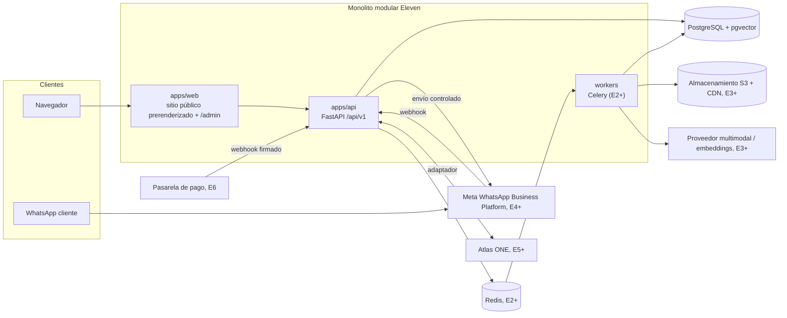

# Arquitectura · Eleven Boutique

Estado: **E1 en construcción**. Este documento describe la arquitectura objetivo y marca qué parte
existe en cada entrega. Nada aquí afirma que integraciones externas (Atlas ONE, Meta, pasarela)
estén disponibles.

Decisiones de base: [ADR-0001](adr/0001-stack-y-estructura-del-repositorio.md) ·
[ADR-0002](adr/0002-render-web-publica-prerender.md) · Pendientes:
[pending-decisions.md](pending-decisions.md)

## 1. Vista general

Principio rector: **web y agente consumen la misma API de catálogo y oferta**. No existe una base
de precios propia del bot ni acceso directo del frontend a tablas de Atlas ONE.

## 2. Procesos

| Proceso | Responsabilidad | Disponible desde |
|---|---|---|
| `web` | Landing, catálogo, ficha, carrito/checkout demo; luego `/admin` | E1 |
| `api` | REST `/api/v1`, autorización, tenant, webhooks (persistir y ACK) | E1 (solo catálogo lectura) |
| `worker` | Importaciones, pipeline de fotos, agente de conversación, sincronización | E2/E3 |
| `scheduler` | Conciliaciones y polling incremental (Celery beat) | E5 |

Los webhooks nunca esperan al LLM ni a terceros: persisten el evento, responden y encolan.

## 3. Módulos de dominio (API)

| Módulo | Responsabilidad | Entrega |
|---|---|---|
| `catalog` | Product, Variant, ChannelListing, colecciones, publicación | E1 (lectura) · E2 (admin) |
| `content` | Contenido de landing, políticas aprobadas y versionadas | E1 (fixtures) · E2 |
| `identity` | Usuarios, roles (editor, revisor, admin), tenant | E2 |
| `audit` | Registro de autor, fecha, versión de cada cambio | E2 |
| `media` | MediaAsset, ingesta, duplicados, derivados, ProductMedia | E2/E3 |
| `vision` | Annotation, Embedding, candidatos, cola de revisión | E3 |
| `conversations` | Customer, Conversation, Message, bandeja humana, agente | E4 |
| `integrations` | Adaptadores Atlas ONE, WhatsApp, pago; ExternalMapping; inbox/outbox | E4–E6 |
| `commerce` | Order, Reservation, Payment, StockSnapshot | E6 (demo en cliente en E1) |

## 4. Datos

Separaciones obligatorias (task pack §6): **producto** (estilo) ≠ **variante** (SKU vendible)
≠ **activo** (foto) ≠ **existencia** (unidades por ubicación) ≠ **oferta de canal** (precio y
publicación) ≠ **pedido** (no es pago).

Reglas de esquema:

- Toda tabla de negocio lleva `tenant_id` con claves foráneas compuestas o restricciones que
  impiden relacionar filas de tenants distintos.
- Unicidad real en BD: `slug` por tenant, `sku` por tenant, `ExternalMapping` en ambos sentidos.
- Precio `NUMERIC(12,2)` nullable: `NULL` significa *Consultar precio*, nunca cero.
- Disponibilidad con tres estados explícitos: `known`, `unknown`, `stale`. Sin fuente
  autorizada la respuesta es `unknown`.
- Estados de publicación: `draft → review → published → archived`.

### Esquema mínimo de E1

`tenant`, `product`, `variant`, `channel_listing`, `media_asset` (solo referencia a archivos
estáticos demo), `product_media`, `collection`, `collection_product`. Todas con columna
`is_demo` o pertenecientes al tenant demo.

## 5. Flujos

1. **Catálogo público:** web → `GET /api/v1/catalog/products` (cursor, filtros, límite máximo) →
   solo productos `published` del tenant resuelto en servidor.
2. **Contacto asistido (E1):** ficha → enlace `wa.me` construido desde configuración con
   producto, variante, cantidad y URL → evento `whatsapp_click`. Un clic no es una venta.
3. **Fotos (E3):** ingesta → SHA-256 y hash perceptual → derivados → atributos (LLM) → embeddings
   → candidatos → revisión humana → asociación → exportación con mapa reversible.
4. **WhatsApp (E4):** webhook → evento persistido y deduplicado → cola por conversación → reglas
   (modo, baja, ventana 24 h) → agente con tools de solo lectura o bandeja humana → envío
   idempotente.
5. **Atlas ONE (E5):** adaptador → mappings → inbox/outbox con versión y correlación →
   conciliación programada. Mientras no exista contrato verificado: `MockAtlasAdapter`
   identificado como tal.
6. **Comercio (E6):** reserva atómica con expiración e idempotencia → pago confirmado solo por
   webhook firmado → surtido. Pagos tardíos van a excepción.

## 6. Seguridad

- Autorización siempre en backend; el tenant nunca se acepta desde el cliente como autorización.
- Originales de fotos privados; solo derivados aprobados son públicos y sin metadatos sensibles.
- Contenido de fotos, OCR y mensajes de clientes son datos no confiables, nunca instrucciones.
- No se registran tokens ni conversaciones completas innecesariamente.
- Medios externos solo desde carga propia o endpoints del proveedor con allowlist (sin SSRF).

## 7. Entornos

| Entorno | Uso | Datos |
|---|---|---|
| `local` | Desarrollo con Docker Compose | Fixtures demo |
| `preview` | Railway, revisión de entregas | Fixtures demo, `DEMO_MODE=true`, `noindex` |
| `production` | Publicación real | Solo lotes aprobados; se crea al cerrar E1/E2 |

## 8. Qué existe hoy

| Componente | Estado |
|---|---|
| Documentación base (este archivo, ADRs, pendientes, README) | EB-01 |
| Monorepo, Docker Compose, fixtures, API mínima, web | Pendiente (EB-02 en adelante) |
